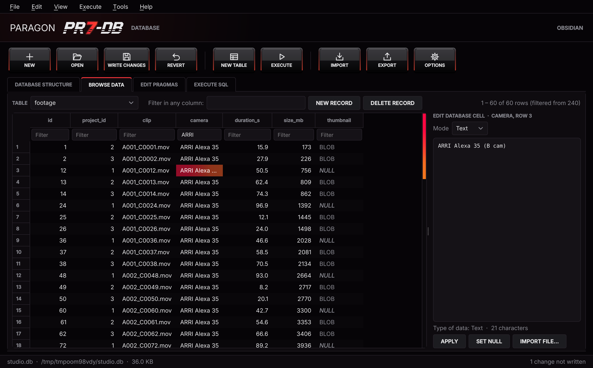
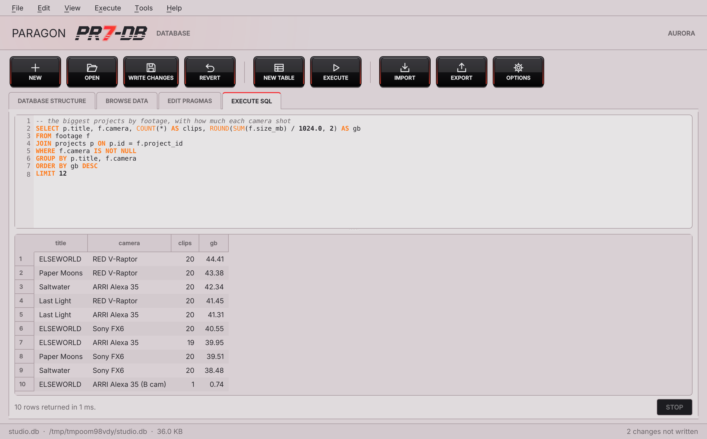
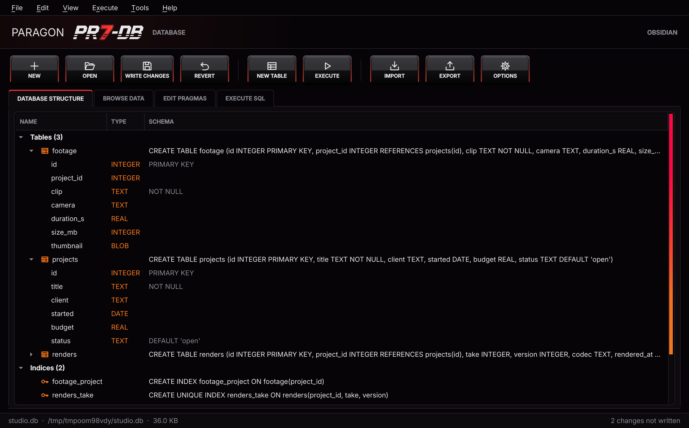

# Paragon PR7-DB

SQLite databases, the way **DB Browser for SQLite** works, in the Paragon family look (PR7-Z, PR7-W, PR7-L, PR7-F,
PR7-E, PR7-R, PR7-P, PR7-M, PR7-Q, PR7-U, PR7-DU, PR7-CB, PR7-IS, PR7-PM, PR7-SM, PR7-HB, PR7-FS, PR7-AR, PR7-WM,
PR7-HX). Python and PySide6; Python's own `sqlite3` does the database work.

## What it does

- **Changes wait for Write Changes** (Ctrl+S), as in DB Browser. Every edit, new or deleted row, table change, import
  and SQL statement goes into one open transaction. **Revert Changes** throws it all away. Changed cells are orange
  until written.
- **Database Structure:** tables with their columns and types, indices, views and triggers, each with its CREATE
  statement. Right-click to browse, modify, delete or copy the statement.
- **Browse Data:**
  - any table or view, fetched a page at a time (millions of rows open at once);
  - a filter under every column, using DB Browser's syntax: text, `=`, `<>`, `>`, `<`, `10~20`, `/regex/`, `=NULL`,
    `<>NULL`; plus a filter for any column;
  - sorting, New / Delete Record;
  - the **Edit Database Cell** panel: text, binary as hex, images, JSON, Set NULL, import a file into a cell.
- **Edit Pragmas:** foreign keys, journal mode, synchronous, page size, user version and the rest of DB Browser's list.
- **Execute SQL:**
  - run all (Ctrl+Return) or the current statement (Shift+F5);
  - highlighting in the family's colours;
  - results fetched as you scroll, and how long it took;
  - the failing statement underlined;
  - Stop for long queries.
- **Create / Modify Table** (DB Browser's grid: type, NN, PK, AI, U, default, check), Create Index, Delete Table.
- **Import / Export:** tables from and to CSV, the database to and from an SQL file.
- **Tools:** Compact Database (VACUUM), Integrity Check, Foreign-Key Check.
- Open read-only (Ctrl+Shift+O). SQLite files can open from Explorer (Open with; .db files are never taken over).

## Building

`pip install -r requirements.txt -r requirements-dev.txt`, `python -m pytest`, `pyinstaller pr7db.spec`, then Inno Setup:
`iscc /DAppVersion=x.y.z installer\pr7db.iss`.
